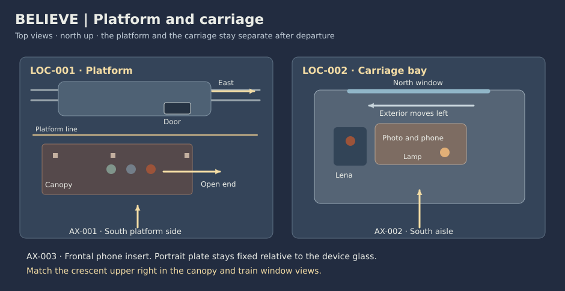

# Believe scene breakdown

Let the audience feel the grip of an unfinished goodbye, then see Lena loosen it. Bring the parents and daughter into the same composition across distance while keeping their spaces distinct.

## Lyric and beat map

These are edit windows against the supplied structure. Each starts at a proposed section boundary.

| Beat | Song section | Picture | Change on screen | Music and sound cue |
| --- | --- | --- | --- | --- |
| BT-001 | Chorus · The same place | 0:00–0:36 | Parents and daughter are together. The photograph and Zoya’s open palm establish what can travel. | Give the first chorus a platform bed and one low door cue. |
| BT-002 | Verse 1 · Let the platform go | 0:36–1:09 | The train pulls away. Lena puts the photograph down and starts the call to prolong the goodbye. | Trade canopy ambience for the carriage’s rolling bed. |
| BT-003 | Chorus · The same call | 1:09–1:45 | A phone frame makes their closeness small. The tunnel takes away the view while the call is still active. | Carry the full chorus through the first black exterior. Change the rolling texture at the tunnel mouth. |
| BT-004 | Verse 2 · Lose the ground | 1:45–2:18 | The carriage sways, the photo slips and the call freezes. Lena’s retry gets no response. | One rail accent, then a more enclosed rolling bed. Any call tone stays beneath the vocal. |
| BT-005 | Chorus · The same sky | 2:18–2:54 | Lena sets the phone face down, turns out the reflected lamp and opens her hand toward the moon. Zoya and Pavel look up from the platform. | Let the chorus have room. The lamp click can mark the new image if it fits. |
| BT-006 | Chorus repeat and fade · Stay apart together | 2:54–3:30 | Zoya touches Pavel’s sleeve. Lena relaxes her hand. Matching edges let the sky carry the last return. | Keep the two place beds distinct under the same song. Let the picture fade with the master tail. |

Credits occupy 3:30–3:36.

## Stage map

Use AX-001 from the south side of the platform and AX-002 from the train aisle, both looking north. The train moves east and the view through its window moves left. AX-003 is a neutral portrait view for the phone plate. Use a familiar post or window edge when returning to either space.

## Scenes

### SC-001 · EXT. STATION PLATFORM – BLUE HOUR

**0:00–0:36 · 36 s · BT-001 · SH-001–SH-004**

Show one family occupying one place, and plant a gesture and a photograph before they have to carry meaning alone. Zoya gives Lena the photograph, then opens her palm toward a gap in the canopy. Pavel steadies Lena’s bag strap. Lena steps into the carriage.

- **Space and time.** LOC-001 · Canopy and waiting carriage door. Evening · before departure.
- **People and props.** CH-001, CH-002, CH-003 · PR-002, PR-005. [Asset references](visual_bible.md#assets).
- **Emotional turn.** Closeness → Reluctance.
- **Entry.** Train still. Family together behind platform line. Photograph with Zoya.
- **Exit.** Lena aboard with photograph in left hand. Parents on platform. Door closed.
- **Axis and viewpoint.** Camera south, rails north. Train nose and exit east, screen right. Keep the moon at upper right beyond canopy. Only contact happens at rest.
- **Sound.** Air and muffled station traffic. One gentle door close under the outgoing chorus.
- **Backup coverage.** Use a platform wide and separate photo insert. Door close can be held with parents’ reaction outside frame.

### SC-002 · INT. CARRIAGE BAY / EXT. PLATFORM – EVENING

**0:36–1:09 · 33 s · BT-002 · SH-005–SH-008**

Give Lena a physical loss of place and a new tactic. Make her hands change from gripping the past to holding a call. Lena tucks the bag below her seat. The platform recedes. She puts the picture flat and raises her phone. Pavel answers under the canopy.

- **Space and time.** LOC-002 and LOC-001 · Seat and canopy. First minutes after boarding.
- **People and props.** CH-001, CH-002, CH-003 · PR-001, PR-002, PR-003, PR-004, PR-005. [Asset references](visual_bible.md#assets).
- **Emotional turn.** Reluctance → Concentrated reassurance.
- **Entry.** Photo in left hand. Train begins moving east. Reading lamp already lit.
- **Exit.** Photo face up near window. Lena’s phone upright in right hand and active. Pavel holds his own phone.
- **Axis and viewpoint.** Train looks north from aisle. Window scenery travels left. Platform insert returns to AX-001 with fixed posts before moving back.
- **Sound.** Begin a single rolling bed as the platform recedes. A quiet answer cue may carry the switch of place.
- **Backup coverage.** Use the window plate and sleeve grip if a moving train exterior is unstable.

### SC-003 · INT. CARRIAGE BAY / EXT. PLATFORM – EVENING

**1:09–1:45 · 36 s · BT-003 · SH-009–SH-012**

Let the screen keep them close while the outside world changes. Make distance readable before the signal fails. Lena watches the call. The parents stand close enough to fit the same screen. The train enters a tunnel and exterior light disappears.

- **Space and time.** LOC-002 and LOC-001 · Two ends of the call. Continuous · into the tunnel.
- **People and props.** CH-001, CH-002, CH-003 · PR-001, PR-002, PR-003, PR-004. [Asset references](visual_bible.md#assets).
- **Emotional turn.** Reassurance → Unease.
- **Entry.** Phone active. Photo face up. Cool exterior visible beyond warm lamp reflection.
- **Exit.** Phone still active on last beat. Tunnel dark outside. Warm lamp unchanged.
- **Axis and viewpoint.** Show the phone portrait image via a separate plate of the same parents and canopy. A frontal device insert has no lateral action axis.
- **Sound.** Hold the music. The platform bed can sit close to the call moment. Dark exterior coincides with enclosed rail tone.
- **Backup coverage.** Cut between fixed portrait plates and a held daughter reaction if screen reflections drift.

### SC-004 · INT. CARRIAGE BAY – TUNNEL TO OPEN AIR

**1:45–2:18 · 33 s · BT-004 · SH-013–SH-016**

Take away the old tactic. Let Lena first try to restore it, then notice the world outside the phone. The bay sways. Lena catches the sliding picture and the call freezes. One retry gives her no answer. Cool sky returns at the window edge.

- **Space and time.** LOC-002 · Table and window. Continuous · tunnel passage.
- **People and props.** CH-001 · PR-001, PR-002, PR-003. [Asset references](visual_bible.md#assets).
- **Emotional turn.** Alarm → Still uncertain, attention lifting.
- **Entry.** Tunnel outside. Phone active in right hand, photo near outer edge.
- **Exit.** Photo resettled face up. Dark phone still in right hand. Cool exterior has returned.
- **Axis and viewpoint.** Keep the train moving right, outside plate left. Confine the photo slip and catch to one insert. Lamp remains on.
- **Sound.** One short rail jolt, then enclosed rolling bed. Brief filtered call decay if space allows. No words are needed.
- **Backup coverage.** Separate the photo slide and the hand on the photo as two matching locked views.

### SC-005 · INT. CARRIAGE BAY / EXT. PLATFORM – NIGHT

**2:18–2:54 · 36 s · BT-005 · SH-017–SH-020**

Show the change as a choice in Lena’s hands. Let the viewers share the sky before the parents and daughter do. Lena sets the phone face down and turns off the lamp. She opens her right palm like Zoya. At the platform’s open end, Zoya does the same. Pavel lowers his phone.

- **Space and time.** LOC-002 and LOC-001 · Window and open canopy end. Moments later · same evening.
- **People and props.** CH-001, CH-002, CH-003 · PR-001, PR-002, PR-003, PR-004. [Asset references](visual_bible.md#assets).
- **Emotional turn.** Uncertainty → Recognition and trust.
- **Entry.** Lamp on with a bright spot in window. Dark phone in Lena’s right hand. Parents near their original post.
- **Exit.** Lena’s phone face down, lamp off and palm open. Parents stand side by side near the open end.
- **Axis and viewpoint.** Use the window view to reorient, then the canopy post to mark the cut back to the platform. Same moon shape and height. The people occupy separate places.
- **Sound.** Clear lamp click if it survives the music. Keep train and platform acoustics distinct under the chorus.
- **Backup coverage.** Cut from lamp switch to an uncluttered window plate. Hold the crescent before returning to the family.

### SC-006 · EXT. PLATFORM / INT. CARRIAGE BAY – NIGHT

**2:54–3:30 · 36 s · BT-006 · SH-021–SH-024**

Leave the connection in the paired frames after the hands have let go. Keep the departure real. Zoya touches Pavel’s sleeve. Lena lets her hand rest beside the photograph. The canopy and window successively frame the same crescent.

- **Space and time.** LOC-001 and LOC-002 · Two frames of sky. Same evening · a short afterbeat.
- **People and props.** CH-001, CH-002, CH-003 · PR-001, PR-002, PR-004. [Asset references](visual_bible.md#assets).
- **Emotional turn.** Trust → Quiet release.
- **Entry.** Parents side by side. Lena’s palm up and phone dark on table.
- **Exit.** Pavel’s phone pocketed. Lena’s hand relaxed and picture face up. Last image is the window’s sky.
- **Axis and viewpoint.** Return to two already mapped edges. No new interface state, reply or viewpoint outside the established spaces.
- **Sound.** Let the arrangement fade over the last held window image. Carry a little wheel texture under the fade.
- **Backup coverage.** Hold SH-024 longer and remove the parent sky insert if the graphic match is hard to read.

[Shot list](shot_list.md) · [Visual bible](visual_bible.md) · [Storyboard](storyboard.md)
