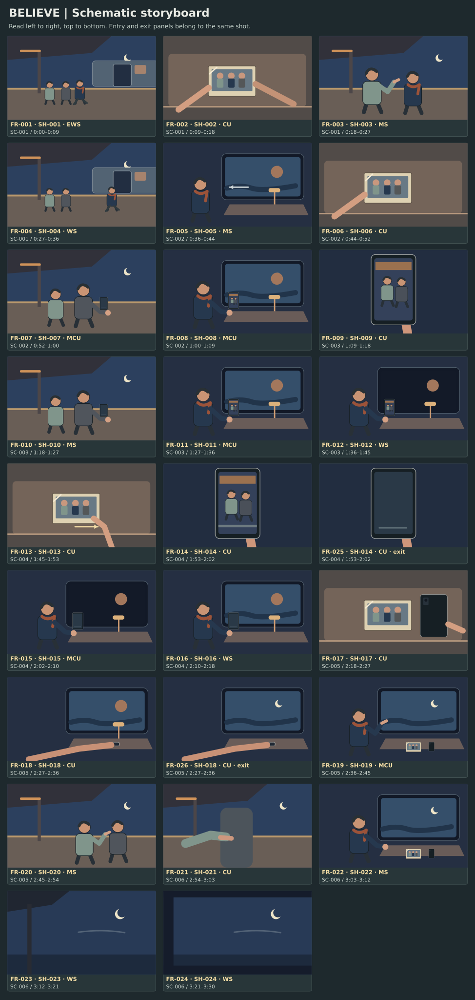

# Believe storyboard

26 schematic panels cover 24 shots. Read left to right and top to bottom. A second panel on a shot shows an entry or exit state.

[Open the silent animatic](animatic.mp4) · [Open the stage map](floor-plan.svg) · [Shot list](shot_list.md)

## Panel index

| Frame | Shot and beat | Time or phase | Reference assets | Frame intention |
| --- | --- | --- | --- | --- |
| FR-001 | SH-001 · BT-001 | 0:00–0:09 | AS-001, AS-002, AS-003, AS-004, AS-007, AS-010, AS-012, AS-013 | Rail at north, family at middle post, train door to right and sky above. |
| FR-002 | SH-002 · BT-001 | 0:09–0:18 | AS-001, AS-002, AS-004, AS-007, AS-010 | Cream photograph at center between two sleeves. |
| FR-003 | SH-003 · BT-001 | 0:18–0:27 | AS-001, AS-002, AS-003, AS-004, AS-007, AS-010, AS-012, AS-013 | Zoya and Lena under the canopy, open east sky over their shoulders. |
| FR-004 | SH-004 · BT-001 | 0:27–0:36 | AS-001, AS-002, AS-003, AS-004, AS-007, AS-010, AS-012, AS-013 | Open door at right, parents centered under post. |
| FR-005 | SH-005 · BT-002 | 0:36–0:44 | AS-001, AS-005, AS-006, AS-007, AS-008, AS-011, AS-013 | Lena at table, window holds recognizable platform post. |
| FR-006 | SH-006 · BT-002 | 0:44–0:52 | AS-001, AS-005, AS-006, AS-007, AS-008, AS-011, AS-013 | Frame holds left hand and table ledge with empty space right. |
| FR-007 | SH-007 · BT-002 | 0:52–1:00 | AS-001, AS-002, AS-003, AS-004, AS-007, AS-009, AS-010, AS-013 | Pavel near post with Zoya just behind, dark green phone below his face. |
| FR-008 | SH-008 · BT-002 | 1:00–1:09 | AS-001, AS-005, AS-006, AS-007, AS-008, AS-011, AS-013 | Lena’s face and right phone in near half, window behind. |
| FR-009 | SH-009 · BT-003 | 1:09–1:18 | AS-001, AS-002, AS-003, AS-004, AS-006, AS-010 | Portrait device center. Parents together against the familiar canopy. |
| FR-010 | SH-010 · BT-003 | 1:18–1:27 | AS-001, AS-002, AS-003, AS-004, AS-007, AS-009, AS-010 | Familiar post frames parents, empty track at top. |
| FR-011 | SH-011 · BT-003 | 1:27–1:36 | AS-001, AS-005, AS-006, AS-007, AS-008, AS-011 | Lena in near half, phone at eye height, window behind. |
| FR-012 | SH-012 · BT-003 | 1:36–1:45 | AS-001, AS-005, AS-006, AS-007, AS-008, AS-011 | Window and warm table lamp share the frame. |
| FR-013 | SH-013 · BT-004 | 1:45–1:53 | AS-001, AS-005, AS-006, AS-007, AS-008, AS-011 | Photo near the table edge, left hand enters below. |
| FR-014 | SH-014 · BT-004 | 1:53–2:02 | AS-001, AS-002, AS-003, AS-004, AS-006, AS-010 | Same device portrait as SH-009, screen centered. |
| FR-025 | SH-014 · BT-004 | exit within 1:53–2:02 | AS-001, AS-002, AS-003, AS-004, AS-006, AS-010 | Display dark with no reply. |
| FR-015 | SH-015 · BT-004 | 2:02–2:10 | AS-001, AS-005, AS-006, AS-007, AS-008, AS-011 | Right thumb and face in one plane, window behind dark. |
| FR-016 | SH-016 · BT-004 | 2:10–2:18 | AS-001, AS-005, AS-006, AS-007, AS-008, AS-011 | Cool exterior moves into window around the warm reflection. |
| FR-017 | SH-017 · BT-005 | 2:18–2:27 | AS-001, AS-005, AS-006, AS-007, AS-008, AS-011, AS-012 | Photo face up. Right hand and phone adjacent. |
| FR-018 | SH-018 · BT-005 | 2:27–2:36 | AS-001, AS-005, AS-006, AS-007, AS-008, AS-011, AS-012 | Right finger on switch, warm lamp and window reflection visible. |
| FR-026 | SH-018 · BT-005 | exit within 2:27–2:36 | AS-001, AS-005, AS-006, AS-007, AS-008, AS-011, AS-012 | Lamp off. Crescent clear in cool window. |
| FR-019 | SH-019 · BT-005 | 2:36–2:45 | AS-001, AS-005, AS-006, AS-007, AS-008, AS-011, AS-012 | Lena’s open hand and the sky in the right half. |
| FR-020 | SH-020 · BT-005 | 2:45–2:54 | AS-001, AS-002, AS-003, AS-004, AS-007, AS-009, AS-010, AS-012 | Parents at open canopy end, sky upper right. |
| FR-021 | SH-021 · BT-006 | 2:54–3:03 | AS-001, AS-002, AS-003, AS-004, AS-007, AS-009, AS-010, AS-012 | Zoya’s hand and Pavel’s sleeve low, a canopy post behind. |
| FR-022 | SH-022 · BT-006 | 3:03–3:12 | AS-001, AS-005, AS-006, AS-007, AS-011, AS-012 | Right hand above the table, window and photo readable together. |
| FR-023 | SH-023 · BT-006 | 3:12–3:21 | AS-004, AS-010, AS-012 | Canopy edge at left, crescent upper right, no people required. |
| FR-024 | SH-024 · BT-006 | 3:21–3:30 | AS-005, AS-011, AS-012 | Window edge echoes canopy edge. Crescent same size and position. |

The [shot records](project.json) give the entry and exit state for each view. Motion in the final piece follows the shot notes. The animatic holds stills for the planned duration, splitting a shot’s time when it has two panels.

## Animatic plan and checks

| Test | Shots or beats | Watch for | Alternate cut |
| --- | --- | --- | --- |
| Shared geography | SH-001 → SH-005 and SH-020 → SH-024 | Viewer tracks separate places and a shared moon. | Retain a canopy post in parent sky and the window edge in the train sky. |
| Loss then choice | SH-012 → SH-019 | The dead call, face-down phone and lamp switch are distinct visible events. | Use locked screen and switch inserts before the window plate. |
| Family gesture | SH-003 → SH-019 → SH-020 | The open palm reads as a recalled family gesture. | Hold the original right palm and cut less quickly to the boarding shot. |
| Reprise rhythm | BT-001, BT-003, BT-005 and BT-006 | The repeated chorus has a different image of togetherness each time. | Test the photo hold and the final moon match against the recorded arrangement. |

The silent assembly uses 3:30 of picture and 6 seconds for the credits reserve. The master will set the exact section markers. Test the held views and the sound bridges again with the actual track, then lock the cut points and keep the motion handles listed in the shot plan.

## Review findings

The silent boards show the dark window before the call fails, then the lamp changing while the crescent remains in place. Canopy and window edges make the two locations distinct at the final match. The cue spacing still needs the recorded chorus.
