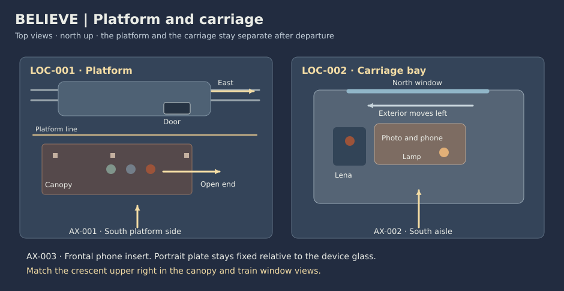

# Believe visual bible

**v0.1 · 16:9 · proposed reference records**

Keep the two places identifiable by their edges. The amber canopy and the carriage’s cooler window get their own light. The rust scarf, paper crease and crescent hold through the cuts.

## Assets

| Reference | Entity | Stable look or geometry | Authorized change |
| --- | --- | --- | --- |
| AS-001 | CH-001 · Lena | v1 · Dark chin-length hair, navy coat, one muted rust scarf with its end tucked inside left lapel. | Scarf and coat stay on. Left hand holds the photograph, right hand works the phone and then opens toward the glass. |
| AS-002 | CH-002 · Zoya | v1 · Silver at temples, sage wool coat, no hat, matte collar. | Remains on platform. Opens right palm at BT-001 and raises it again at BT-005. |
| AS-003 | CH-003 · Pavel | v1 · Charcoal jacket, dark blue cap, squared shoulders. | Holds his phone with his right hand. Lowers it at BT-005 and lets Zoya touch his left sleeve at BT-006. |
| AS-004 | LOC-001 · Platform | v1 · Rail at north side, dry platform below it, canopy posts and open east end. Amber canopy fixtures. | Door closes before the train moves east. Parents stay behind the platform line and later walk to the open end. |
| AS-005 | LOC-002 · Carriage bay | v1 · Two seats, table, north-facing window, warm reading lamp at the aisle edge, navy canvas bag below Lena’s seat. | Exterior moves left as train travels east. Tunnel blacks out exterior at BT-003. Reading lamp goes out at BT-005. |
| AS-006 | PR-001 · Lena’s phone | v1 · Matte black, small corner nick, portrait orientation. | In right hand through BT-004. Call freezes and dims. Face down on table at BT-005 and remains there. |
| AS-007 | PR-002 · Family photograph | v1 · Small cream-edged print of the three, pale crease at upper left. | Zoya passes it to Lena’s left hand. Face up by the window, slides at BT-004 and is resettled face up. |
| AS-008 | PR-003 · Reading light | v1 · Small warm lamp and black switch on the aisle edge of table, one reflected highlight near window center. | Light stays on through the tunnel. Lena switches it off at BT-005. Ambient cabin and sky light remain. |
| AS-009 | PR-004 · Pavel’s phone | v1 · Dark green case, portrait. | He raises it for the call at BT-002. Lowers it to waist after the call ends, then pockets it during the fade. |
| AS-010 | LGT-A · Platform look | v1 · Deep indigo sky from north. Amber pools under canopy; open east end has a clear view of the crescent. | Cold sky stays put while performers pass from warmer cover toward open blue sky. |
| AS-011 | LGT-B · Train look | v1 · Cool window spill from north; warm reading light from aisle side; dim cool floor practical. | Tunnel takes away window fill. When reading light goes out, window becomes the brightest area. |
| AS-012 | SKY-001 · Shared crescent | v1 · Small pale crescent with a slight tilt, upper right of both sky compositions. Cloud trace at lower edge. | Repeat the outline and apparent height in the platform and train views. Allow only gentle cloud drift. |
| AS-013 | PR-005 · Travel bag | v1 · Soft navy canvas with one short loop and a brass zip. | Lena wears it at boarding. Bag stays below her seat from BT-002 through the fade. |

The logical references describe the versions to use in board and frame review. The storyboard uses simplified silhouettes and prop shapes for those versions.

## Layout and camera

| Coverage position | Viewpoint | Lens intent and focus |
| --- | --- | --- |
| platform | South of the platform line or under canopy. Eye level toward north, or up at the open end. | 35–50 mm equivalent, wider for route. Faces and canopy landmark readable. |
| aisle | South aisle of the carriage, window north. Seated eye level or close from aisle side. | 35–65 mm equivalent, preserve depth behind Lena. Eyes or near hand sharp, window readable when it carries story. |
| detail | Aisle side of table or neutral view onto a held object. Steep close insert without swapping the hand or object. | Macro or 85 mm equivalent. The named edge, switch or point of contact. |
| device | Neutral portrait insert, display or separated front-camera plate. Square to device glass. | 65–85 mm equivalent field, controlled reflections. Image plane and device edge readable. |
| sky | Inside the established window or under open canopy edge. Upward, north sky in matched composition. | 40–55 mm equivalent and matched apparent moon size. Frame edge and distant silhouette recognizable. |

## Palette and light

| Look | Palette anchors | Continuity |
| --- | --- | --- |
| platform | `#191f34` · `#344763` · `#b57441` · `#688478` · `#c6b8a4` | Amber from mapped canopy, indigo from open sky. |
| train | `#141c2a` · `#3d5774` · `#a4583d` · `#c88d5d` · `#ced8dd` | Warm lamp local to table; sky fill returns after tunnel, warm reflection goes away only at SH-018. |

## Hero frames and state changes

| Use | Board reference | State to compare |
| --- | --- | --- |
| Family at departure | [FR-001, FR-003](storyboard.md#panel-index) | Stationary train, canopy post, first open right palm. |
| Call failure | [FR-014 → FR-025](storyboard.md#panel-index) | Live portrait held, then dark screen. Same right hand, lamp still warm. |
| Reading light | [FR-018 → FR-026](storyboard.md#panel-index) | Warm reflection disappears. Cool exterior and crescent stay. |
| Shared sky | [FR-023 → FR-024](storyboard.md#panel-index) | Same crescent size and height, two unmistakable framing edges. |

## Rule choices

| Rule | Direction | Review test |
| --- | --- | --- |
| [DIR-002](../../rulebooks/02_directing.md#dir-002) | Begin with one shared frame, go with Lena into the carriage and return to her parents by known landmarks. | A viewer can say who knows the call has failed and how each later looks up. |
| [CIN-CAM-004](../../rulebooks/03_cinematography.md#cin-cam-004) | Train travel is east, screen right from the platform and window scenery left from inside. | Step through SH-004 → SH-005 and SH-011 → SH-012 to verify direction. |
| [MIS-007](../../rulebooks/04_mise_en_scene.md#mis-007) | The photograph remains in Lena’s care, and the phone stays face down after the third chorus begins. | Track hand, print orientation and screen state at every join. |
| [LGT-010](../../rulebooks/05_lighting_and_color.md#lgt-010) | Lose exterior fill at the tunnel, then remove one warm reflection with the reading switch. | Pause before and after SH-018. The moon is in the same part of the window. |
| [EDT-010](../../rulebooks/07_montage_and_editing.md#edt-010) | The final match carries the same crescent across two different edges. | Check the cut SH-023 → SH-024 at full speed without the score. |
| [SND-010](../../rulebooks/06_sound_design.md#snd-010) | Let the chorus recur as the image changes its meaning. | Keep the same song continuous while rail and platform beds identify the cut. |
