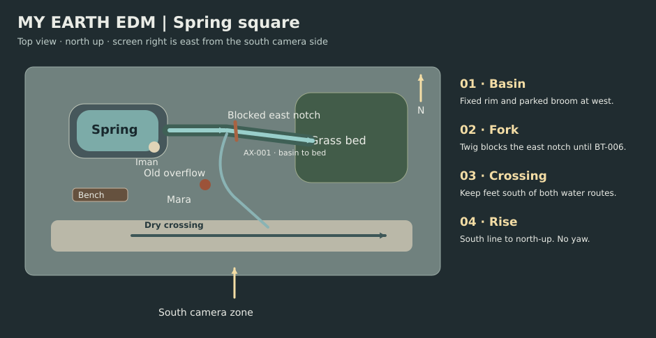

# My Earth EDM scene breakdown

Begin with the pressure of a route everyone has to cross. Bring the audience down to the height of a bare hand and let a small act of care change how the whole square moves.

## Lyric and beat map

These are edit windows against the supplied structure. Each starts at a proposed section boundary.

| Beat | Song section | Picture | Change on screen | Music and sound cue |
| --- | --- | --- | --- | --- |
| BT-001 | Verse 1 · Rush and return | 0:00–0:40 | Mara sweeps water aside. It runs back into the crossing. | Tire hiss over the music, then isolate the spring’s off-screen trickle. |
| BT-002 | Build-up · Trace it upstream | 0:40–0:56 | She parks the broom and frees her right hand at the spring. | Keep traffic in a continuous bed and move the trickle forward. |
| BT-003 | Drop · Make contact | 0:56–1:30 | Her palm enters water. She notices how little of it reaches the grass. | First downbeat on contact. Keep the following image steady. |
| BT-004 | Verse 2 · Follow the living pattern | 1:30–2:06 | Ripples and two seasonal details lead back to the obstructed garden outlet. | Wind and water can bridge the associative cuts. Return clearly to the square. |
| BT-005 | Build-up 2 · Make room to work | 2:06–2:22 | Iman sets down his tote and lifts the leaf mat. The twig still blocks the low notch. | Small leaf scrape in a gap if the recording allows. |
| BT-006 | Drop 2 · Release the flow | 2:22–2:56 | Mara clears the twig. The visible front of water travels east into the grass. | Anchor the drop to release, then let the movement finish before the next accent. |
| BT-007 | Breakdown · Share the care | 2:56–3:18 | They clear the leaves and make room for people to choose the dry crossing. | Give pan and footsteps a little space beneath the music. |
| BT-008 | Final Drop · See the whole square | 3:18–3:54 | The camera rises along the runnel to the shared view. | Keep the music wide and a trace of the spring present under the last view. |

Credits occupy 3:54–4:00.

## Stage map

Use AX-001 along the basin-to-bed route. Stage the old overflow toward the south paving and the garden path east. Set the camera on the south side for the eastward reads. A north-up insert or overhead keeps the same rightward direction.

## Scenes

### SC-001 · EXT. SPRING SQUARE – MORNING

**0:00–0:40 · 40 s · BT-001 · SH-001–SH-004**

Show the overflow as a small problem Mara can try to solve. Establish the only crossing, the source side and the planted strip. Pedestrians pass left to right. Mara sweeps the thin sheet away. It curls back around the broom, and she looks upstream.

- **Space and time.** LOC-001 · South crossing and low basin. One morning · before contact.
- **People and props.** CH-001, CH-002 · PR-001. [Asset references](visual_bible.md#assets).
- **Emotional turn.** Hurry → Attention caught.
- **Entry.** Both gloves on, broom in Mara’s hands, Iman moving past with tote. Thin overflow crosses the paving.
- **Exit.** Same overflow returns, broom held still. Mara is looking up and left toward the spring.
- **Axis and viewpoint.** Stay south of basin-to-garden axis. Keep the audience with Mara. The source is heard before its mouth is singled out.
- **Sound.** Continuous plaza traffic and shoe bed. Water starts off screen. Place its first clear location with Mara’s head turn.
- **Backup coverage.** Use SH-001 plus the boot and broom inserts if background walkers drift.

### SC-002 · EXT. SPRING BASIN AND GARDEN EDGE – MORNING

**0:40–1:30 · 50 s · BT-002, BT-003 · SH-005–SH-010**

Change scale and listening perspective. Show the intact spring and the dry destination before explaining the blockage. Mara follows the overflow, rests her broom, pockets her right glove and cups the spring water. She touches the grass beyond the outlet.

- **Space and time.** LOC-001 · Basin south lip and garden curb. Same morning · a few steps later.
- **People and props.** CH-001 · PR-001. [Asset references](visual_bible.md#assets).
- **Emotional turn.** Distracted → Present and curious.
- **Entry.** Gloves on, source murmurs, broom carried, runoff toward paving.
- **Exit.** Broom against basin west wall. Bare right hand wet, left glove on. Grass bed still dry.
- **Axis and viewpoint.** Right hand enters near foreground and touches water once. Keep the spring at frame left in wider shots and the grass right.
- **Sound.** Narrow the traffic bed toward Mara’s listening position. One clear contact accent on Drop 1, then a held moment.
- **Backup coverage.** Split the water contact into a fixed rim insert and Mara’s held reaction.

### SC-003 · EXT. BASIN AND ASSOCIATIVE GRASS DETAILS – MORNING

**1:30–2:06 · 36 s · BT-004 · SH-011–SH-014**

Give the lyric’s seasonal scale an image, then return to evidence of why the garden is dry. Basin ripple leads to two fixed grass views with changed season cues. Return to the actual fork where leaves and twig block the east notch.

- **Space and time.** LOC-001 · Basin and garden · associative macro inserts. Present morning framing a seasonal association.
- **People and props.** CH-001 · PR-002. [Asset references](visual_bible.md#assets).
- **Emotional turn.** Curious → Understands the route.
- **Entry.** Wet right hand, dry garden, bypass running south.
- **Exit.** Same place and costume. Mara can see the wet leaf mat and the twig at the east mouth.
- **Axis and viewpoint.** SH-012 and SH-013 are matched abstract time inserts. SH-014 restores the same morning and frame orientation.
- **Sound.** Bridge both macros with the same water motif. Reopen the square’s room tone on the return.
- **Backup coverage.** Use one season echo and retain the wide outlet reveal if the time shift reads as literal.

### SC-004 · EXT. STONE FORK – MORNING

**2:06–2:56 · 50 s · BT-005, BT-006 · SH-015–SH-020**

Let a new tactic and help pay off. The viewer must see which object blocks which direction, and where the first water goes. Mara points out the east notch to Iman. He puts the tote down, lifts the leaves and holds them to the left. Mara frees the twig. Water runs right into the bed.

- **Space and time.** LOC-001 · Basin, east notch and curb. Continuous.
- **People and props.** CH-001, CH-002 · PR-002, PR-003. [Asset references](visual_bible.md#assets).
- **Emotional turn.** Intent and cooperation → Relief.
- **Entry.** Leaf mat and twig block the east notch. Broom parked. Tote on Iman’s left shoulder.
- **Exit.** Leaves held to west lip, twig laid beside them. Bare right hand and cuff damp, water entering grass from the west.
- **Axis and viewpoint.** Mara works nearest the south lip. Iman takes the west edge. Match cuts across twig clearance and first movement of water.
- **Sound.** Build-up on lift and hesitation. Second drop begins at twig clearance. Use continuous water from the same source.
- **Backup coverage.** SH-016 shows both people and the fork in a fixed frame. Cut from it to SH-018 if hand detail fails.

### SC-005 · EXT. SPRING SQUARE CROSSING – MORNING

**2:56–3:18 · 22 s · BT-007 · SH-021–SH-023**

Show shared care becoming ordinary behavior as the square reopens. Iman brings the leaf pan from the bench. Together they clear the lip. Mara retrieves the broom. Iman returns for his tote and takes the dry crossing.

- **Space and time.** LOC-001 · West lip, south bench and crossing. A few minutes later.
- **People and props.** CH-001, CH-002 · PR-001, PR-002, PR-003. [Asset references](visual_bible.md#assets).
- **Emotional turn.** Relief → Quiet fellowship.
- **Entry.** Bed receiving water, debris at west lip. Tote and empty leaf pan on bench. Broom parked.
- **Exit.** Leaves and twig in pan on bench. Mara has broom, Iman has tote. Dry pedestrian line stays south.
- **Axis and viewpoint.** Allow the old overflow sheen to remain. Feet follow the dry route around it. Keep one walker at a time in close coverage.
- **Sound.** Footsteps and soft pan scrape under the breakdown. Water bed continues without a reset.
- **Backup coverage.** Hold SH-023 and cut to SH-024 once the shared route reads.

### SC-006 · EXT. SPRING SQUARE ABOVE THE CROSSING – MORNING

**3:18–3:54 · 36 s · BT-008 · SH-024–SH-027**

Reveal how a narrow runnel and a human route can occupy one frame. Make flight a feeling of space opening. People resume crossing. Mara watches the flow. The view rises in stages and holds over the basin, grass and path.

- **Space and time.** LOC-001 · Whole square. Same morning · final release.
- **People and props.** CH-001, CH-002 · PR-001, PR-003. [Asset references](visual_bible.md#assets).
- **Emotional turn.** Fellowship → Expansion and ease.
- **Entry.** Water enters east bed, walkers go left to right on the dry crossing, Mara holds broom.
- **Exit.** Same layout and flow, seen from above. No growth or change of weather. Cut to credits.
- **Axis and viewpoint.** Rise without yaw. Top view stays north up with grass right and crossing below. The last view can be a held board with subtle water movement.
- **Sound.** Final drop is the widest music moment. Keep a little water under the last held image.
- **Backup coverage.** Replace the lift with a cut to a high locked wide and then the overhead.

[Shot list](shot_list.md) · [Visual bible](visual_bible.md) · [Storyboard](storyboard.md)
