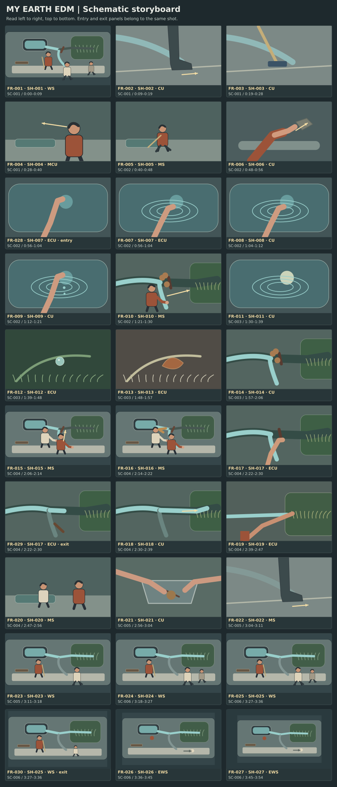

# My Earth EDM storyboard

30 schematic panels cover 27 shots. Read left to right and top to bottom. A second panel on a shot shows an entry or exit state.

[Open the silent animatic](animatic.mp4) · [Open the stage map](floor-plan.svg) · [Shot list](shot_list.md)

## Panel index

| Frame | Shot and beat | Time or phase | Reference assets | Frame intention |
| --- | --- | --- | --- | --- |
| FR-001 | SH-001 · BT-001 | 0:00–0:09 | AS-001, AS-002, AS-003, AS-004, AS-007 | Basin left of center, garden right, walkway near edge. Eyes follow moving boots. |
| FR-002 | SH-002 · BT-001 | 0:09–0:19 | AS-001, AS-002, AS-003, AS-004, AS-007 | Wet diagonal enters upper left. Shoe and splash fill lower right. |
| FR-003 | SH-003 · BT-001 | 0:19–0:28 | AS-001, AS-002, AS-003, AS-004, AS-007 | Blue bristles low left, returning sheet crosses the center. |
| FR-004 | SH-004 · BT-001 | 0:28–0:40 | AS-001, AS-002, AS-003, AS-004, AS-007 | Face right of frame, leave left open for her upstream gaze. |
| FR-005 | SH-005 · BT-002 | 0:40–0:48 | AS-001, AS-003, AS-004, AS-007 | Mara centered in profile, low rim ahead left. |
| FR-006 | SH-006 · BT-002 | 0:48–0:56 | AS-001, AS-003, AS-004, AS-007 | Hands above dark rim, left jacket pocket visible at the end. |
| FR-028 | SH-007 · BT-003 | entry within 0:56–1:04 | AS-001, AS-003, AS-004, AS-007 | Fingertips above surface. |
| FR-007 | SH-007 · BT-003 | 0:56–1:04 | AS-001, AS-003, AS-004, AS-007 | Bare hand in foreground, pale ring starts beneath fingertips. |
| FR-008 | SH-008 · BT-003 | 1:04–1:12 | AS-001, AS-003, AS-004, AS-007 | Ring fills center, sky light drifts softly in one corner. |
| FR-009 | SH-009 · BT-003 | 1:12–1:21 | AS-001, AS-003, AS-004, AS-007 | Palm near center, dry stone and green edge at right. |
| FR-010 | SH-010 · BT-003 | 1:21–1:30 | AS-001, AS-003, AS-004, AS-007 | Mara low left, small green bed visible at right and fork between. |
| FR-011 | SH-011 · BT-004 | 1:30–1:39 | AS-003, AS-007 | Pale disc and an incomplete ring share the center. |
| FR-012 | SH-012 · BT-004 | 1:39–1:48 | AS-003, AS-008 | Grass tips curve in from left, dew at center. |
| FR-013 | SH-013 · BT-004 | 1:48–1:57 | AS-003, AS-008 | Repeat the grass curve, copper leaf and thin frost at center. |
| FR-014 | SH-014 · BT-004 | 1:57–2:06 | AS-001, AS-003, AS-005, AS-007 | North-up insert shows fork center, bypass down and bed right. |
| FR-015 | SH-015 · BT-005 | 2:06–2:14 | AS-001, AS-002, AS-003, AS-005, AS-006, AS-007 | Mara foreground left of bed, Iman behind at west lip. |
| FR-016 | SH-016 · BT-005 | 2:14–2:22 | AS-001, AS-002, AS-003, AS-005, AS-006, AS-007 | Both at low edges of the fork, dry bed on right. |
| FR-017 | SH-017 · BT-006 | 2:22–2:30 | AS-001, AS-002, AS-003, AS-005, AS-006, AS-007 | Dark twig across the low notch, bare fingers central. |
| FR-029 | SH-017 · BT-006 | exit within 2:22–2:30 | AS-001, AS-002, AS-003, AS-005, AS-006, AS-007 | Twig clear; the water front has just moved past its old position. |
| FR-018 | SH-018 · BT-006 | 2:30–2:39 | AS-001, AS-002, AS-003, AS-005, AS-006, AS-007 | Water front stays central, grass already visible at right. |
| FR-019 | SH-019 · BT-006 | 2:39–2:47 | AS-001, AS-002, AS-003, AS-005, AS-006, AS-007 | Same blade cluster as SH-010, water at the bottom edge. |
| FR-020 | SH-020 · BT-006 | 2:47–2:56 | AS-001, AS-002, AS-003, AS-005, AS-006, AS-007 | Mara near right, Iman west left, bed between them in depth. |
| FR-021 | SH-021 · BT-007 | 2:56–3:04 | AS-001, AS-002, AS-003, AS-004, AS-005, AS-006, AS-007 | Pan enters from left, moving hands above it. |
| FR-022 | SH-022 · BT-007 | 3:04–3:11 | AS-001, AS-002, AS-003, AS-004, AS-005, AS-006, AS-007 | Two lines separated by the curb. Feet in the lower third. |
| FR-023 | SH-023 · BT-007 | 3:11–3:18 | AS-001, AS-002, AS-003, AS-004, AS-005, AS-006, AS-007 | Mara and grass right of center, walkway clear in front. |
| FR-024 | SH-024 · BT-008 | 3:18–3:27 | AS-001, AS-002, AS-003, AS-004, AS-006, AS-007 | Same side as SH-001, spring left, planted strip right, walkway below. |
| FR-025 | SH-025 · BT-008 | 3:27–3:36 | AS-001, AS-002, AS-003, AS-004, AS-006, AS-007 | Runnel points east while the walkway opens at the bottom. |
| FR-030 | SH-025 · BT-008 | exit within 3:27–3:36 | AS-001, AS-002, AS-003, AS-004, AS-006, AS-007 | High oblique view holding both routes. |
| FR-026 | SH-026 · BT-008 | 3:36–3:45 | AS-001, AS-002, AS-003, AS-004, AS-006, AS-007 | North-up spring and east bed, dry line along bottom. |
| FR-027 | SH-027 · BT-008 | 3:45–3:54 | AS-001, AS-002, AS-003, AS-004, AS-006, AS-007 | Whole square, arcs of path and water, no dominant face. |

The [shot records](project.json) give the entry and exit state for each view. Motion in the final piece follows the shot notes. The first two drop accents use FR-007 and FR-029 at their section starts. FR-028 and FR-017 preserve the preceding contact and twig states for coverage review. For the lift, the animatic splits SH-025 between its two panels.

## Animatic plan and checks

| Test | Shots or beats | Watch for | Alternate cut |
| --- | --- | --- | --- |
| Obstruction and payoff | SH-014 → SH-017 → SH-018 → SH-019 | A muted viewer can follow the blocking twig and the water’s first arrival in the bed. | Start with SH-016 wider, then cut on the first clear movement east. |
| Time insert | SH-011 → SH-014 | The paired macros read as Mara’s association, and present morning resumes at the same fork. | Keep only SH-012 and bridge it with the spring bed. |
| Final lift | SH-024 → SH-027 | The rising view reveals both routes before the last hold. | Cut straight from SH-024 to SH-026 and hold the top frame. |
| Music hierarchy | BT-003, BT-006, BT-008 | Contact, release and shared scale land as different ideas even with the same song energy. | Spot exact beats after master delivery. Remove extra Foley if it masks the kick. |

The silent assembly uses 3:54 of picture and 6 seconds for the credits reserve. The master will set the exact section markers. Test the held views and the sound bridges again with the actual track, then lock the cut points and keep the motion handles listed in the shot plan.

## Review findings

The silent boards connect the blocked fork, clearing twig and wet grass in sequence. The wider ending keeps the basin, channel and crossing oriented the same way. The lift’s speed and the flow match still need moving coverage tests.
