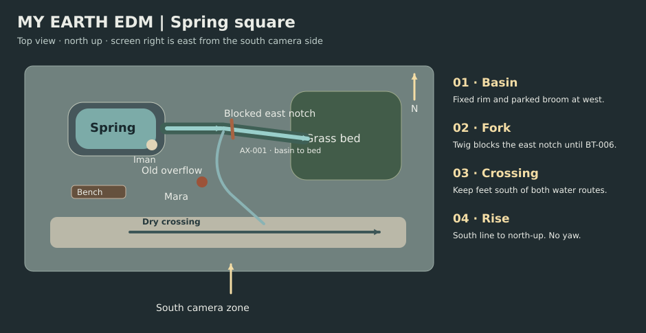

# My Earth EDM visual bible

**v0.1 · 16:9 · proposed reference records**

Keep the square ordinary at first. Slate paving, a clay work jacket and a small green bed give the water somewhere specific to go. The frame grows wider as Mara sees more of the place.

## Assets

| Reference | Entity | Stable look or geometry | Authorized change |
| --- | --- | --- | --- |
| AS-001 | CH-001 · Mara | v1 · Slate hair tied low, clay work jacket, charcoal trousers, matte gray gloves, two patch pockets. | Right glove off and into her left jacket pocket at BT-002. Right fingertips stay wet after BT-003 and darken the right cuff during BT-006. |
| AS-002 | CH-002 · Iman | v1 · Short hair, off-white overshirt, dark blue trousers, small navy canvas tote on left shoulder. | Enters west to east. Tote set on the dry south bench at BT-005 and retrieved at BT-007. |
| AS-003 | LOC-001 · Spring square | v1 · North low source basin, stone fork to east garden or south pavers, fixed dry crossing to south, low bench at southwest. | Only the overflow pattern and pedestrian route change. Basin rim, fork and bed edges stay fixed. |
| AS-004 | PR-001 · Broom | v1 · Birch handle, one blue bristle strip, squared head. | Mara carries it. She leans it against the west basin wall in BT-002 and retrieves it at BT-007. |
| AS-005 | PR-002 · Wet leaf mat and twig | v1 · Thin amber leaves across garden mouth, one dark twig wedged across the low notch. | Iman lifts leaves to west lip in BT-005. Mara removes the twig in BT-006. Both end in her leaf pan in BT-007. |
| AS-006 | PR-003 · Leaf pan | v1 · Low matte galvanized pan on dry south bench, same size and rounded rim throughout. | Iman brings it to west lip for cleanup in BT-007. Leaves and twig stay in it thereafter. |
| AS-007 | LGT-A · Morning look | v1 · Cool open sky, high soft dawn from northeast, graphite paving, clay jacket and muted spring greens. | Same sun side all morning. Use wider contrast at the final reveal as more sky enters the frame. |
| AS-008 | LGT-B · Associative macro look | v1 · Fixed grass crescent and central grass tips, soft backlight, wider palette allowed on details. | BT-004 only. Green dew to a copper leaf with frost on the same silhouette. No human or world state carries over. |

The logical references describe the versions to use in board and frame review. The storyboard uses simplified silhouettes and prop shapes for those versions.

## Layout and camera

| Coverage position | Viewpoint | Lens intent and focus |
| --- | --- | --- |
| street | South curb, across the crossing. Eye level or low as noted, south of AX-001. | 28 mm equivalent for wide geography. Crossing and rim readable in moderate depth. |
| near | South side of basin, at Mara’s shoulder or hand height. Oblique from south. | 50 mm equivalent for hand and reaction scale. Hold on the named hand, face or lip. |
| insert | South lip or top of the fork with north up. Low or steep insert as noted. | Macro or 85 mm equivalent, shallow but adequate contact depth. Contact plane and target remain legible. |
| high | South-central line above the square. High oblique to overhead, north up at top. | 28–35 mm equivalent with stable edges. Basin, channel and crossing in depth. |

## Palette and light

| Look | Palette anchors | Continuity |
| --- | --- | --- |
| day | `#29383d` · `#607578` · `#9ea6a0` · `#a45437` · `#44664b` · `#a8c7bf` | Fixed northeast dawn and sky fill across the square. |
| season | `#242d34` · `#9b6a43` · `#c4c5b6` · `#729c85` | Backlit macro insert only. Return to the same square look at SH-014. |

## Hero frames and state changes

| Use | Board reference | State to compare |
| --- | --- | --- |
| Whole square before repair | [FR-001](storyboard.md#panel-index) | Pavers receive overflow. East bed and south crossing visible. |
| Right hand and spring | [FR-028 → FR-007](storyboard.md#panel-index) | Right glove in left patch pocket. Hand enters once, at the rim. |
| Garden outlet | [FR-014, FR-017 → FR-029](storyboard.md#panel-index) | Leaf mat at west lip by release. Twig leaves east notch, first water moves east. |
| Overhead continuity | [FR-030, FR-027](storyboard.md#panel-index) | Basin left, grass right, walking route stays separate. |

## Rule choices

| Rule | Direction | Review test |
| --- | --- | --- |
| [DIR-002](../../rulebooks/02_directing.md#dir-002) | Start at Mara’s working height and withhold a clear look at the spring until she turns. | On a muted pass, mark the look that changes her route. |
| [MIS-001](../../rulebooks/04_mise_en_scene.md#mis-001) | Keep water west to east and the dry crossing south in the wide and overhead. | Trace both paths from SH-001, SH-016 and SH-027. |
| [EDT-002](../../rulebooks/07_montage_and_editing.md#edt-002) | Cut from twig clearance to the first water traveling right. | Step the join and verify that the water front advances once. |
| [CIN-CAM-017](../../rulebooks/03_cinematography.md#cin-cam-017) | Lift only after the new route works. | Compare the rise with a cut to the same high composition. |
| [SND-010](../../rulebooks/06_sound_design.md#snd-010) | Separate touch, release and expansion across the three drops. | Spot the actual drop transients against SH-007, SH-017/018 and SH-024 after the master arrives. |
