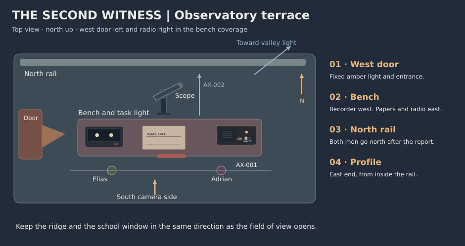

# The Second Witness scene breakdown

Begin with the Count sure of where authority sits. Make him wait for a voice from beyond the observatory, then let him ask that voice to show him where to look.

## Beat clock

Each scene changes what Adrian knows or what he’s willing to do. The credits reserve is 5:12–5:20.

| Beat | Scene and window | Pursuit and resistance | Visible or audible turn | Emotion |
| --- | --- | --- | --- | --- |
| BT-001 · A discovery already has a name | SC-001 · 0:00–0:44 | Adrian wants Elias ready to make the house’s announcement. Elias has a prediction and one instrument. | Adrian puts the exclusive notice in front of Elias. Elias leaves it unsigned and makes a blank line on the observation slip. | Anticipation → An assumption challenged |
| BT-002 · The empty line needs an observer | SC-002 · 0:44–1:32 | Elias asks Adrian to call the other telescope. The family expects to report first. | Elias shows the reference and the empty log line, then points out a light across the valley. Adrian asks what Elias would say if someone were looking back. | Defensiveness → Curiosity in conflict with duty |
| BT-003 · A voice answers from the valley | SC-003 · 1:32–2:20 | Get the night school onto the exact target and keep both logs independent. Time is short and the first call carries no guarantee of agreement. | Adrian keys the direct line. Nera replies and agrees to record if the school is named. Elias sends the field and tells her they will compare afterward. | Hesitation → Commitment to test |
| BT-004 · One star goes out | SC-004 · 2:20–3:20 | See whether the target changes while the reference holds. The dip may occur only once and the hill record alone settles little. | The left point dims and returns. The right point holds. Elias marks his own log. He asks Nera to read hers first, and she reports the same pattern. | Concentration → Shared surprise |
| BT-005 · The Count reads her name | SC-005 · 3:20–4:20 | Adrian has to decide how to report a result that now has two authors. The unsigned exclusive notice is still ready for the trustees. | He asks for Nera’s full name, alters the notice, moves the selector to OPEN and names both observers. Elias commits to release the paired logs. | Surprise and the old obligation → A choice made in public |
| BT-006 · Ask where to look | SC-006 · 4:20–5:12 | Adrian wants to see the sky the other observer sees. His attention has been on the screen and his own notice. | Adrian asks Nera for a place to start. He and Elias go to the rail and look above the same roof light. The frame gives them and the ridge time to hold. | Release → Wonder with room for someone else |

## Stage map

AX-001 runs from the west stair door to the east radio end of the bench. Keep the camera south for the conversation, with Elias left and Adrian right at the bench. AX-002 is the neutral south-to-north view toward the valley. Overhead inserts keep the recorder left and the radio right.

## Scene states

### SC-001 · EXT. PRIVATE OBSERVATORY TERRACE – NIGHT

**0:00–0:44 · 44 s · BT-001 · SH-001–SH-004**

Show the promise Adrian brought up the steps before we hear his reason for keeping it.

- **Space and time.** LOC-001 · West door and observing bench. One cold night · before the window.
- **Characters and props.** CH-001, CH-002 · PR-001, PR-002, PR-003, PR-004. [Asset references](visual_bible.md#assets).
- **Entry.** Radio in DIRECT. Target and reference steady. Notice in Adrian’s right hand.
- **Exit.** Notice clipped at west bench edge, unsigned. Elias holds the pencil. The second line on the slip is blank.
- **Sound.** West door latch, then one continuous night bed. Soft recorder tick from left.
- **Backup coverage.** Use the terrace master and a readable notice insert if the approach track drifts.

### SC-002 · EXT. OBSERVING BENCH – NIGHT

**0:44–1:32 · 48 s · BT-002 · SH-005–SH-008**

Give both men a reason to care and reveal where the second scope is.

- **Space and time.** LOC-001 · Bench and northeast sightline. Continuous.
- **Characters and props.** CH-001, CH-002 · PR-001, PR-002, PR-003, PR-004. [Asset references](visual_bible.md#assets).
- **Entry.** Adrian beside the notice. Valley station out of the viewer’s view.
- **Exit.** Both know where the independent observer is. Adrian looks from the valley to the radio.
- **Sound.** Keep voices near, wind low at the railing. Leave a breath after Elias’s answer about listening.
- **Backup coverage.** Use the bench two-shot, then show the valley only when Adrian looks.

### SC-003 · EXT. RADIO END OF THE BENCH – NIGHT

**1:32–2:20 · 48 s · BT-003 · SH-009–SH-012**

Turn the distant light into an observer with her own terms.

- **Space and time.** LOC-001 · East end of bench. Continuous · just before the prediction.
- **Characters and props.** CH-001, CH-002, CH-003 · PR-001, PR-002, PR-003. [Asset references](visual_bible.md#assets).
- **Entry.** DIRECT selected. Second line blank. No valley voice yet.
- **Exit.** DIRECT still selected. Nera has the field. Both stations will hold their reports until after the event.
- **Sound.** One brief relay hiss. Nera’s near-mono voice from screen right. Return to the same wind and the left-hand tick between replies.
- **Backup coverage.** Cut from key contact to Adrian’s listening face. Composite selector markings in post.

### SC-004 · EXT. TELESCOPE BAY – NIGHT

**2:20–3:20 · 60 s · BT-004 · SH-013–SH-017**

Let the audience see the test and feel the wait for a second answer.

- **Space and time.** LOC-001 · Scope and west recorder. The predicted window.
- **Characters and props.** CH-001, CH-002, CH-003 · PR-001, PR-002, PR-003, PR-004. [Asset references](visual_bible.md#assets).
- **Entry.** Two steady points. Both friends stand at the bench. Radio quiet.
- **Exit.** Target restored. Hill slip marked. Nera has reported one dip and a steady reference.
- **Sound.** Hold the bed and allow one recorder tick before the dim. Leave space after the target returns, then hear Nera without score.
- **Backup coverage.** Use a locked two-dot plate and a held Adrian reaction. Keep the reference visible through the event.

### SC-005 · EXT. RADIO END OF THE BENCH – NIGHT

**3:20–4:20 · 60 s · BT-005 · SH-018–SH-022**

Make the change in Adrian’s position visible in the paper and audible on the open line.

- **Space and time.** LOC-001 · Notice, log and radio. Immediately after the observation.
- **Characters and props.** CH-001, CH-002, CH-003 · PR-001, PR-002, PR-003, PR-004. [Asset references](visual_bible.md#assets).
- **Entry.** DIRECT mode. Exclusive notice unsigned. Hill record marked, school unnamed.
- **Exit.** EXCLUSIVE struck out. School name on the second line. OPEN pilot on and joint notice read aloud.
- **Sound.** Pencil on paper, one distinct switch click. Keep the public read dry and close. Give the speaker a short reply gap.
- **Backup coverage.** Separate pencil, toggle and the uninterrupted line read. Preserve their order.

### SC-006 · EXT. NORTH RAIL – NIGHT

**4:20–5:12 · 52 s · BT-006 · SH-023–SH-026**

Leave the two men with a new way to stand together and a person they are prepared to listen to.

- **Space and time.** LOC-001 · North rail and open sky. A few breaths later.
- **Characters and props.** CH-001, CH-002, CH-003 · PR-001, PR-002, PR-003, PR-004. [Asset references](visual_bible.md#assets).
- **Entry.** Joint log left on bench, pencil across it, OPEN pilot stays on.
- **Exit.** Adrian right of Elias at rail. Valley window below the ridge and open sky above. The log stays on the bench.
- **Sound.** Nera’s last instruction comes from the bench, behind them as they move. Let wind and the unbroken night bed carry the last held image.
- **Backup coverage.** Use the pair at the rail and a locked sky plate in the same direction if the upward move is unreliable.

## Setup and payoff

- BT-001 → BT-005. The empty line and exclusive notice give Adrian two different ways to report the same result.
- BT-002 → BT-004. The steady reference makes the single change readable. Nera speaks after the hill record is written.
- BT-002 → BT-006. A distant window becomes a source of direction when Adrian asks where to look.

[Scene workflow](../../workflows/04_scene_breakdown.md) · [Timed shot list](shot_list.md)
