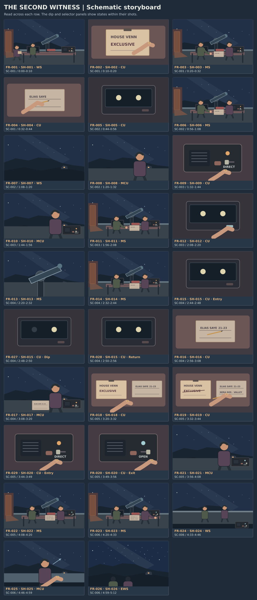

# The Second Witness storyboard

29 schematic frames cover the 26-shot cut. The extra phases show the two-point result and the radio selector. Read left to right and top to bottom.

[Silent captioned animatic](animatic.mp4) · [Floor plan](floor-plan.svg) · [Timed shot list](shot_list.md)

## Frame index

| Frame | Shot and beat | Phase and hold | Reference assets | State |
| --- | --- | --- | --- | --- |
| FR-001 | SH-001 · BT-001 | Selected view · 10 s | AS-001, AS-002, AS-004, AS-005, AS-009, AS-010 | Door ajar, Adrian at right of Elias. |
| FR-002 | SH-002 · BT-001 | Selected view · 10 s | AS-001, AS-002, AS-005, AS-009 | EXCLUSIVE legible on clipped notice. |
| FR-003 | SH-003 · BT-001 | Selected view · 12 s | AS-001, AS-002, AS-004, AS-005, AS-006, AS-007, AS-008, AS-009, AS-010 | Both sheets readable and unsigned. |
| FR-004 | SH-004 · BT-001 | Selected view · 12 s | AS-001, AS-005, AS-008, AS-009 | Second line blank. Elias holds the pencil. |
| FR-005 | SH-005 · BT-002 | Selected view · 12 s | AS-007, AS-009 | Both steady, pointing hand clears frame. |
| FR-006 | SH-006 · BT-002 | Selected view · 12 s | AS-001, AS-002, AS-004, AS-005, AS-006, AS-007, AS-008, AS-009, AS-010 | Both looking north-east. |
| FR-007 | SH-007 · BT-002 | Selected view · 12 s | AS-004, AS-009, AS-010 | Same window located for both men. |
| FR-008 | SH-008 · BT-002 | Selected view · 12 s | AS-002, AS-004, AS-009, AS-010 | He looks down at the radio. |
| FR-009 | SH-009 · BT-003 | Selected view · 12 s | AS-002, AS-006, AS-009 | DIRECT unchanged, key released after the question. |
| FR-010 | SH-010 · BT-003 | Selected view · 12 s | AS-002, AS-003, AS-006, AS-009 | He has heard Nera and asks her to record. |
| FR-011 | SH-011 · BT-003 | Selected view · 12 s | AS-001, AS-002, AS-003, AS-004, AS-005, AS-006, AS-007, AS-009 | Direct agreement given, line still blank until the joint record. |
| FR-012 | SH-012 · BT-003 | Selected view · 12 s | AS-001, AS-007, AS-009 | Send indicator flashes once and clears. |
| FR-013 | SH-013 · BT-004 | Selected view · 12 s | AS-004, AS-007, AS-009, AS-010 | Scope settled, no further change. |
| FR-014 | SH-014 · BT-004 | Selected view · 12 s | AS-001, AS-002, AS-003, AS-004, AS-005, AS-006, AS-007, AS-008, AS-009 | Key clear, both still watching. |
| FR-015 | SH-015 · BT-004 | Entry · 4 s | AS-007, AS-009 | Both target and reference are steady. |
| FR-027 | SH-015 · BT-004 | Dip · 2 s | AS-007, AS-009 | Target dims. The reference stays steady. |
| FR-028 | SH-015 · BT-004 | Return · 6 s | AS-007, AS-009 | Target has returned. Reference has held through all three panels. |
| FR-016 | SH-016 · BT-004 | Selected view · 12 s | AS-001, AS-005, AS-008, AS-009 | Hill time marked, second line blank. |
| FR-017 | SH-017 · BT-004 | Selected view · 12 s | AS-002, AS-003, AS-005, AS-006, AS-009 | Adrian has matched the reports. |
| FR-018 | SH-018 · BT-005 | Selected view · 12 s | AS-002, AS-003, AS-005, AS-009 | Both pages adjacent. School has given its name. |
| FR-019 | SH-019 · BT-005 | Selected view · 12 s | AS-001, AS-002, AS-005, AS-008, AS-009 | Notice struck, Nera named, pencil in Adrian’s right hand. |
| FR-029 | SH-020 · BT-005 | Entry · 5 s | AS-002, AS-006, AS-009 | Guard closed, selector in DIRECT and warm pilot on. |
| FR-020 | SH-020 · BT-005 | Exit · 7 s | AS-002, AS-006, AS-009 | Guard open, selector in OPEN and pale cyan pilot on. |
| FR-021 | SH-021 · BT-005 | Selected view · 12 s | AS-002, AS-003, AS-005, AS-006, AS-009 | Key released, OPEN remains lit. |
| FR-022 | SH-022 · BT-005 | Selected view · 12 s | AS-001, AS-002, AS-003, AS-004, AS-005, AS-006, AS-007, AS-008, AS-009 | Both men at rest. Adrian looks past the bench. |
| FR-023 | SH-023 · BT-006 | Selected view · 13 s | AS-001, AS-002, AS-003, AS-004, AS-005, AS-006, AS-007, AS-008, AS-009, AS-010 | Key released, both ready to move north. |
| FR-024 | SH-024 · BT-006 | Selected view · 13 s | AS-001, AS-002, AS-004, AS-009, AS-010 | Men at rail, radio behind them and still open. |
| FR-025 | SH-025 · BT-006 | Selected view · 13 s | AS-002, AS-004, AS-009, AS-010 | Eyes skyward, palm resting open on rail. |
| FR-026 | SH-026 · BT-006 | Selected view · 13 s | AS-001, AS-002, AS-004, AS-009, AS-010 | Same view as the film cuts to credits. |

## Cut review

| Moment | Review | Fallback |
| --- | --- | --- |
| The observation · SH-015–017 | The target holds four seconds, dips for two, then returns for six. The reference stays put. The visual result precedes Nera’s voice in the cut. | Use a single locked graphic and hold Adrian’s response. Reuse the target position from SH-005. |
| The choice · SH-019–022 | The open pilot appears before Adrian names both observers. The edit leaves room to hear the name and the short reply. | Keep paper, selector and line read as three separate setups. |
| The rail · SH-023–026 | The night-school window is placed before the move, then kept in the wider final view. | Stay on the neutral north-facing view once the pair reaches the rail. |

The silent board uses selected lines as captions and reserves 8 seconds for credits. Time the full performance and radio pauses against the picture before fixing final trims. Use one night bed and place Nera’s radio at the east end before the men move away.

[Storyboard workflow](../../workflows/06_storyboard.md) · [Frame generation handoff](../../workflows/07_frame_generation.md)
