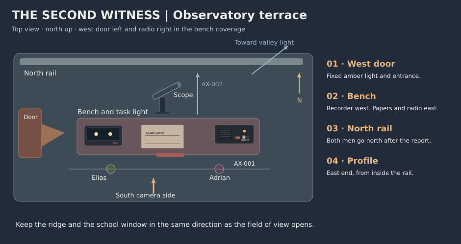

# The Second Witness visual bible

**v0.1 · 16:9 · proposed reference states**

The terrace has three distinct lights. A warm door lamp marks the house, a small red lamp marks the shared work, and the cool sky becomes more visible as the camera looks away from both practicals.

## Assets

| Asset | Entity | Fixed reference | Authorized change |
| --- | --- | --- | --- |
| AS-001 | CH-001 · Dr. Elias Saye | v1 · Fortyish astronomer, slate knit cap, dark olive coat and gray cuffs. Bare fingers at the bench. | At left of bench throughout. Gives the pencil to Adrian in SC-005. Stands left at the rail. |
| AS-002 | CH-002 · Count Adrian Venn | v1 · Fortyish, deep plum wool overcoat, neat collar, right-hand signet, bare hands. | Right of Elias at the bench and rail. Right hand pushes the talk key in SC-003 and moves the open selector in SC-005. |
| AS-003 | CH-003 · Nera Dos | v1 · Adult night-school observer heard from the valley. Deliberate, matter of fact, audible space around the voice. | Radio only. First reply in SC-003. Reads her observation before she hears the hill log. |
| AS-004 | LOC-001 · Private hilltop terrace | v1 · West stair door, bench at center, scope north of bench, rail to north, valley roof light beyond east end. | One fixed layout through the night. Friends move from bench to rail only in SC-006. |
| AS-005 | PR-001 · Notice and joint log | v1 · Cream notice sheet with estate heading clipped at west edge of bench. Separate narrow observation slip with two signature lines. | Notice is flat. Elias marks his slip in SC-004. In SC-005 Adrian strikes EXCLUSIVE once and writes Nera’s name on the free line. |
| AS-006 | PR-002 · Radio | v1 · Dark metal base, speaker at right, talk key at center, guarded selector with DIRECT and OPEN states. | DIRECT and warm pilot through SH-019. OPEN and pale cyan pilot from SH-020 through the tail. |
| AS-007 | PR-003 · Telescope and recorder | v1 · Short charcoal instrument on one fixed pier, a single screened recorder on left half of bench. Target display left, reference right. | Small aim adjustment in SC-004. Target dips once and returns. Reference point holds. Screen returns to standby only after credits. |
| AS-008 | PR-004 · Pencil | v1 · Plain yellow hexagonal pencil, worn eraser. | Elias has it until SC-005. Adrian receives it, edits the notice and lays it across the two lines of the log before leaving. |
| AS-009 | LGT-A · Night and task lights | v1 · Cool sky from north, low red task lamp at south bench edge, warm door light at west. | Fixed intensities in the world. Camera allows the sky to read more fully at the rail. Radio pilot shift is separate. |
| AS-010 | SKY-001 · Ridge and night sky | v1 · Dark ridge slopes slightly down east. One valley station window below its right shoulder. Sparse initial stars in narrow frames. | Same ridge, window and time of night. Final view shows more sky above it and holds. |

## Palette

| Look | Color anchors | Placement and change |
| --- | --- | --- |
| Terrace | #151e31, #364759, #9caebb | Cool night from the open north side. Retain ridge silhouette from beginning to end. |
| Bench | #491e29, #9b4a46, #d2b99c | Dim red task light on the near edge. Scope and paper remain readable by local light. |
| House | #201b23, #6e4532, #bc8a58 | One steady amber door practical at west. Its pool stops short of the observation bench. |
| Public line | #6d5038, #83a9aa | Direct mode warm pilot, open mode pale cyan. Toggle changes only when Adrian transmits the joint notice. |

## Geometry and coverage

AX-001 runs from the west stair door to the east radio end of the bench. Keep the camera south for the conversation, with Elias left and Adrian right at the bench. AX-002 is the neutral south-to-north view toward the valley. Overhead inserts keep the recorder left and the radio right. The rail profile comes from the east end, with the camera on the terrace side of the stone.

| Position | View and angle | Lens and focus |
| --- | --- | --- |
| terrace | South side across the terrace. Eye level or slightly low, northward. | 28–35 mm equivalent for geography and sky. Friends, roofline and bench readable. |
| pair | South side of bench on AX-001. Eye level toward north. | 40–55 mm equivalent for relationship scale. Same focus plane when both speak. |
| elias | South-east of Elias, still south of the conversation axis. Eye level at shoulder height. | 65–75 mm equivalent for restrained perspective. Eyes and near shoulder. |
| adrian | South-west of Adrian, still south of the conversation axis. Eye level at shoulder height. | 65–75 mm equivalent for the listening face. Eyes and near shoulder. |
| insert | South edge of bench, or overhead with north up. Tight steep or square view as noted. | Macro or 85 mm equivalent. One readable contact plane or graphic. |
| north | From south of rail along AX-002. Eye height toward valley or a measured upward tilt. | 32–40 mm equivalent for near rim and distant sky. Retain a ridge line to anchor the sky. |
| profile | East end of the north rail, on the terrace side. Eye level in profile, looking west along the stone. | 65–75 mm equivalent for the eye and hand. Keep the resting hand and profile on one readable plane. |

## Story-critical frames

| Frame | Test |
| --- | --- |
| FR-002, FR-004 | Keep the notice cream and the observation slip visibly separate. The second line is open. |
| FR-015 → FR-027 → FR-028 | One point dips and returns. Keep camera, framing, reference light and screen texture fixed. |
| FR-029 → FR-020 | Hold the same radio body and signet hand as the pilot changes from warm to pale cyan. |
| FR-007 → FR-026 | The valley window remains under the same right shoulder of the ridge as the field of view opens. |

| Rule | Choice | Review test |
| --- | --- | --- |
| [DRA-007](../../rulebooks/01_dramaturgy.md#dra-007) | Adrian arrives with a prepared exclusive notice and ends by choosing the open line. | Track who controls the paper and selector before and after his choice. |
| [DIR-002](../../rulebooks/02_directing.md#dir-002) | Follow Adrian’s attention from the bench to the valley and back, then give him the north-facing sky. | A first viewer can identify when he hears the proof and when he changes the announcement. |
| [MIS-001](../../rulebooks/04_mise_en_scene.md#mis-001) | Keep the west door, center bench and east radio in consistent screen order. | Trace both actors’ positions on the floor plan before boarding any reverse. |
| [SND-008](../../rulebooks/06_sound_design.md#snd-008) | Let the valley window precede Nera’s voice. Preserve the radio source when the men step away. | Play SC-003 and SC-006 without the picture and place the voice at the same bench. |
| [EDT-002](../../rulebooks/07_montage_and_editing.md#edt-002) | Hold the target and reference together through the dip and return. | A muted viewer can say which point changed once. |
| [LGT-010](../../rulebooks/05_lighting_and_color.md#lgt-010) | Keep the red and amber practicals fixed while opening the sky at the rail. | Compare the same ridge and roof light between the first view and final hold. |

[Storyboard](storyboard.md)
